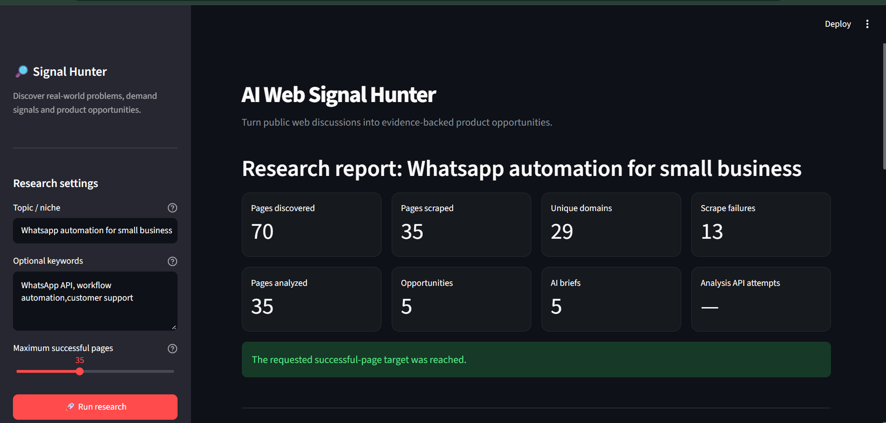
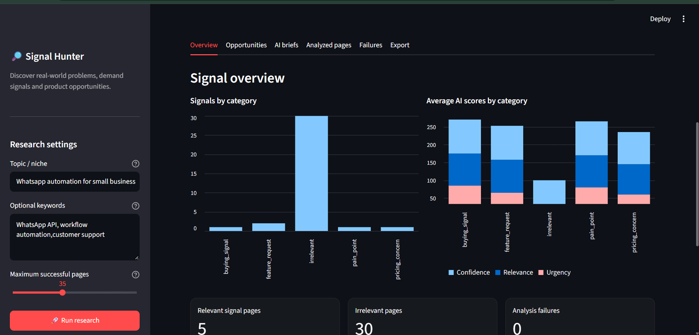
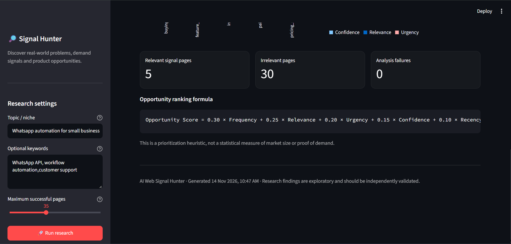
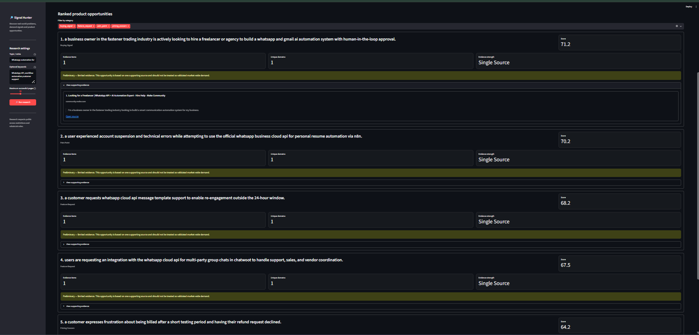
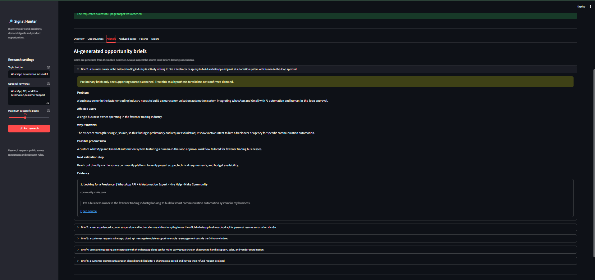
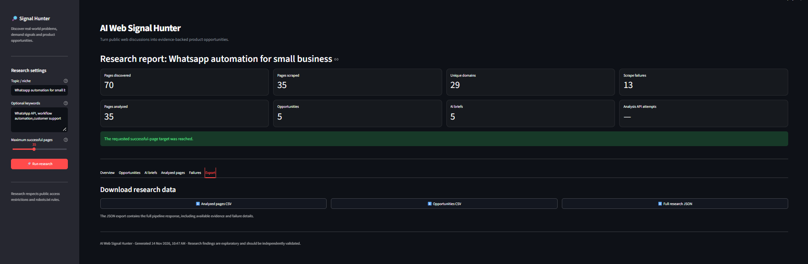

# AI Web Signal Hunter

An AI-powered web intelligence application that discovers public webpages, extracts meaningful market signals, identifies recurring themes, and ranks potential product opportunities using evidence-backed analysis.

## 1. Overview

AI Web Signal Hunter helps users investigate a topic or business niche by collecting information from publicly accessible webpages and analyzing it with Google Gemini.

The application identifies potential market signals, groups similar findings, ranks opportunities, and generates concise opportunity briefs supported by source evidence.

## 2. Key Features

- Topic-based web research and URL discovery.
- Webpage scraping and content extraction.
- Content cleaning and duplicate removal.
- AI-powered signal classification using Google Gemini.
- Structured analysis with summaries, evidence excerpts, relevance, urgency, and confidence scores.
- Similar-signal grouping and opportunity ranking.
- AI-generated opportunity briefs.
- Interactive Streamlit dashboard.
- Filterable research findings.
- CSV and JSON exports.
- Environment-based API configuration.

## 3. Signal Categories

The application classifies analyzed webpages into:

- Pain points
- Buying and demand signals
- Feature requests
- Pricing concerns
- Competitor activity
- Irrelevant content

Each analyzed page retains its source URL and supporting evidence for verification.

## 4. Technology Stack

| Component | Technology |
|---|---|
| Programming Language | Python |
| Dashboard | Streamlit |
| Web Discovery | Tavily |
| Web Scraping | Requests, BeautifulSoup |
| AI Analysis | Google Gemini |
| Data Processing | Pandas |
| Environment Configuration | Python dotenv |

## 5. Project Structure

```text
ai-web-signal-hunter/
│
├── app.py
├── config.py
├── requirements.txt
├── .env.example
├── .gitignore
│
├── crawler/
│   ├── __init__.py
│   ├── discovery.py
│   ├── scraper.py
│   ├── cleaner.py
│   └── robots_checker.py
│
├── analysis/
│   ├── __init__.py
│   ├── llm_analyzer.py
│   ├── prompts.py
│   ├── validator.py
│   ├── opportunity_ranker.py
│   ├── opportunity_briefs.py
│   └── brief_prompts.py
│
├── services/
│   ├── __init__.py
│   ├── pipeline.py
│   └── storage.py
│
├── data/
└── exports/
```

## 6. Installation and Setup

### Prerequisites

- Python 3.10 or later
- Tavily API key
- Google Gemini API key

### Step 1: Clone the repository

```bash
git clone <YOUR_GITHUB_REPOSITORY_URL>
cd ai-web-signal-hunter
```

### Step 2: Create a virtual environment

```bash
python -m venv venv
```

Activate on Windows:

```bash
venv\Scripts\activate
```

### Step 3: Install dependencies

```bash
pip install -r requirements.txt
```

### Step 4: Configure environment variables

Create a `.env` file in the project root using `.env.example` as a reference.

```env
TAVILY_API_KEY=your_tavily_api_key_here
GEMINI_API_KEY=your_gemini_api_key_here
GEMINI_MODEL=gemini-3.5-flash-lite
```

Use your own API credentials. Never commit the actual `.env` file or expose API keys publicly.

### Step 5: Run the application

```bash
streamlit run app.py
```

The Streamlit dashboard will open in your browser.

## 7. System Architecture

The application follows a modular research pipeline.

1. **Web Discovery:** Tavily discovers webpages relevant to the user's research topic.
2. **Crawling:** The scraper retrieves publicly accessible webpage content.
3. **Content Cleaning:** Extracted content is cleaned and duplicate pages are removed.
4. **AI Analysis:** Google Gemini analyzes the cleaned content and identifies market signals.
5. **Validation:** Structured AI responses are validated before being used.
6. **Signal Grouping:** Similar findings are grouped into recurring themes.
7. **Opportunity Ranking:** Groups are scored using a weighted ranking method.
8. **Brief Generation:** AI generates opportunity briefs based on the ranked evidence.
9. **Dashboard and Export:** Results are presented through Streamlit and can be exported as CSV or JSON.

## 8. Opportunity Ranking Methodology

The application uses a weighted scoring model to prioritize recurring opportunities.

### Scoring Formula

```text
Opportunity Score =
    (0.30 × Frequency)
  + (0.25 × Relevance)
  + (0.20 × Urgency)
  + (0.15 × Confidence)
  + (0.10 × Recency)
```

Each component is evaluated on a 0–100 scale.

### Scoring Components

| Component | Weight | Description |
|---|---:|---|
| Frequency | 30% | Considers how many unique source domains support a recurring signal. |
| Relevance | 25% | Average relevance score of the grouped findings. |
| Urgency | 20% | Average urgency score of the grouped findings. |
| Confidence | 15% | Average confidence score of the grouped findings. |
| Recency | 10% | Measures how recently the supporting pages were crawled. |

### Additional Ranking Logic

- Findings classified as irrelevant are excluded from opportunity ranking.
- Similar findings are grouped using text similarity, with a `SequenceMatcher` threshold of 0.65.
- Frequency considers unique source domains rather than simply counting repeated pages from the same domain.
- Relevance, urgency, and confidence are averaged across the findings in a group.
- Recency uses a crawl-date decay: the score starts at 100 and decreases by 10 points for each elapsed day, with a minimum of 0.

The resulting opportunity score is a prioritization heuristic, not an objective measure of market demand or commercial success. Each opportunity should be evaluated alongside its supporting evidence and source links.

## 9. Sample Research Run

The application was tested using a WhatsApp-related research topic.

Observed results from one research run:

- 64 webpages discovered.
- 35 webpages successfully scraped.
- 26 unique domains represented.
- 12 scraping failures.
- 35 webpages analyzed.
- 3 opportunities identified.
- 3 AI-generated opportunity briefs.

The research identified feature requests and pain points from public discussions.

The number of opportunities depends on the quality, diversity, and strength of the evidence collected. The application does not fabricate additional opportunities when the available evidence is insufficient.

## 10. Dashboard and Export

The Streamlit dashboard provides:

- Research overview and page statistics.
- Signal category summaries and charts.
- Ranked opportunity cards.
- AI-generated opportunity briefs.
- Filterable analyzed-page details.
- Supporting evidence and source links.
- Crawl and analysis failure information.
- CSV exports for analyzed pages and opportunities.
- JSON export of the full research response.

## 11. Limitations

- Research quality depends on the relevance and availability of public webpages.
- Some websites restrict automated access or return incomplete content.
- AI-generated classifications and summaries may require human verification.
- API rate limits and service availability can affect analysis.
- The number of opportunities depends on the strength of the collected evidence.
- The current prototype uses Google Gemini for AI analysis and Tavily for web discovery.
- Opportunity scores are intended to support research prioritization, not replace business validation.

## 12. Responsible Crawling

The application is designed for research using publicly accessible webpages.

- Respect website terms and crawling restrictions.
- Check robots.txt and applicable permissions.
- Avoid login-protected and paywalled content.
- Do not bypass CAPTCHAs or access controls.
- Use reasonable request rates.
- Preserve original source URLs for evidence verification.
- Do not collect private or sensitive personal information.

## 13. Future Improvements

- Improve discovery coverage and source diversity.
- Enhance signal clustering and opportunity detection.
- Improve evidence-grounded validation.
- Add additional AI providers.
- Expand dashboard analytics and reporting.

## Author

Developed as an AI-powered web intelligence and opportunity discovery project.

## Application Screenshots

### Main Dashboard


### Signal Analytics


### Opportunity Ranking


### Ranked Opportunities


### AI-Generated Briefs


### Exports

